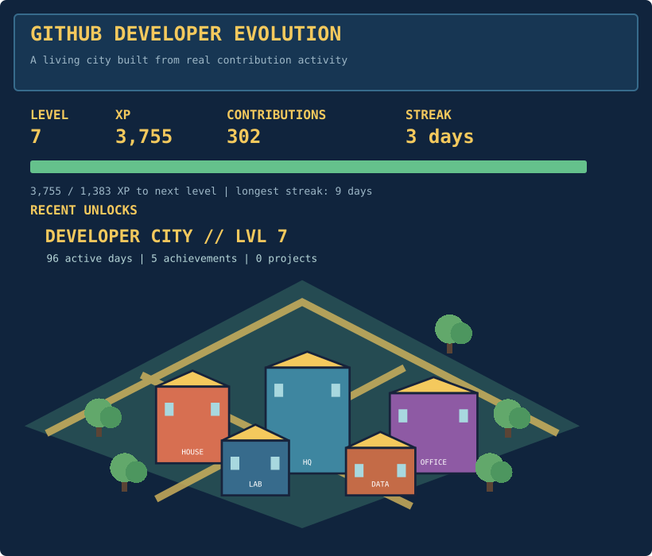

# GitHub Developer Evolution

An automated progression system that turns real GitHub contribution activity into an evolving isometric pixel-art developer city.

## Setup

```bash
python3.12 -m venv .venv
source .venv/bin/activate
pip install -r requirements.txt
cp .env.example .env
```

Set `GITHUB_TOKEN` and `GITHUB_USERNAME` in `.env`. The token needs access to the GraphQL contribution calendar. Private contributions are disabled by default; enable the account setting and set `PRIVATE_CONTRIBUTIONS=true` only when you want private activity included and the token has the required access.

## Local execution

The mock mode exercises the complete state, progression, renderer, and README pipeline without contacting GitHub:

```bash
PYTHONPATH=src python -m github_evolution.main --mock
pytest
```

Live synchronization uses the last 365 days from GitHub's contribution calendar as the canonical total. State writes are atomic and per-day XP deltas prevent duplicate rewards on repeated runs.

## Projects

Register explicitly completed projects in `config/projects.yaml`:

```yaml
projects:
  - name: Orbital API
    description: Distributed telemetry service
    repository: https://github.com/pinsara23/orbital-api
    completion_date: 2026-10-12
    category: Distributed Systems
    xp: 900
    building: data-center
```

Only entries in this file are rewarded; repositories are never assumed complete automatically.

## GitHub Actions and profile README

The workflow runs at `18:30 UTC`, which is midnight in Sri Lanka, and can also be started with **Run workflow**. `GITHUB_TOKEN` is supplied by Actions and the workflow has only `contents: write` permission. Enable Actions for the repository and ensure the repository setting permits workflows to create and push commits.

The generated dashboard is inserted between stable markers immediately before `<!-- DEVELOPER-EVOLUTION:START -->

<!-- DEVELOPER-EVOLUTION:END -->

## GitHub Activity`; existing profile content and statistics remain intact.

## Outputs

- `generated/developer-dashboard.svg` contains the profile-ready dashboard.
- `generated/developer-city.svg` contains the city scene.
- `data/state.json` stores versioned progression state.
- `config/` controls XP, achievements, city tiers, and projects.

## License

MIT. See [LICENSE](LICENSE).
